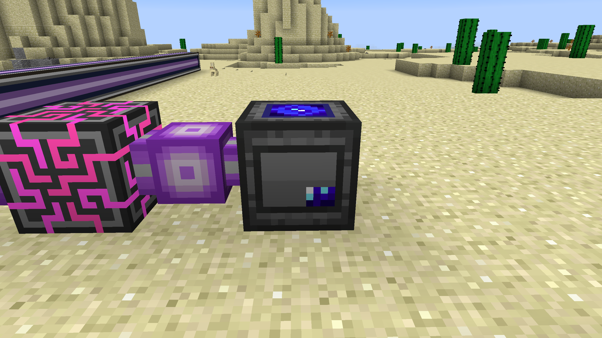
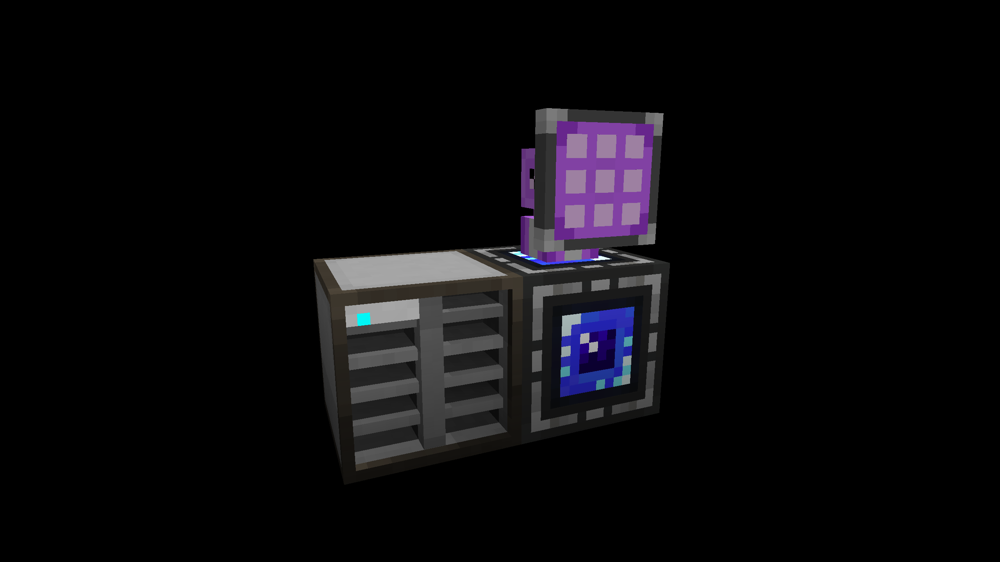
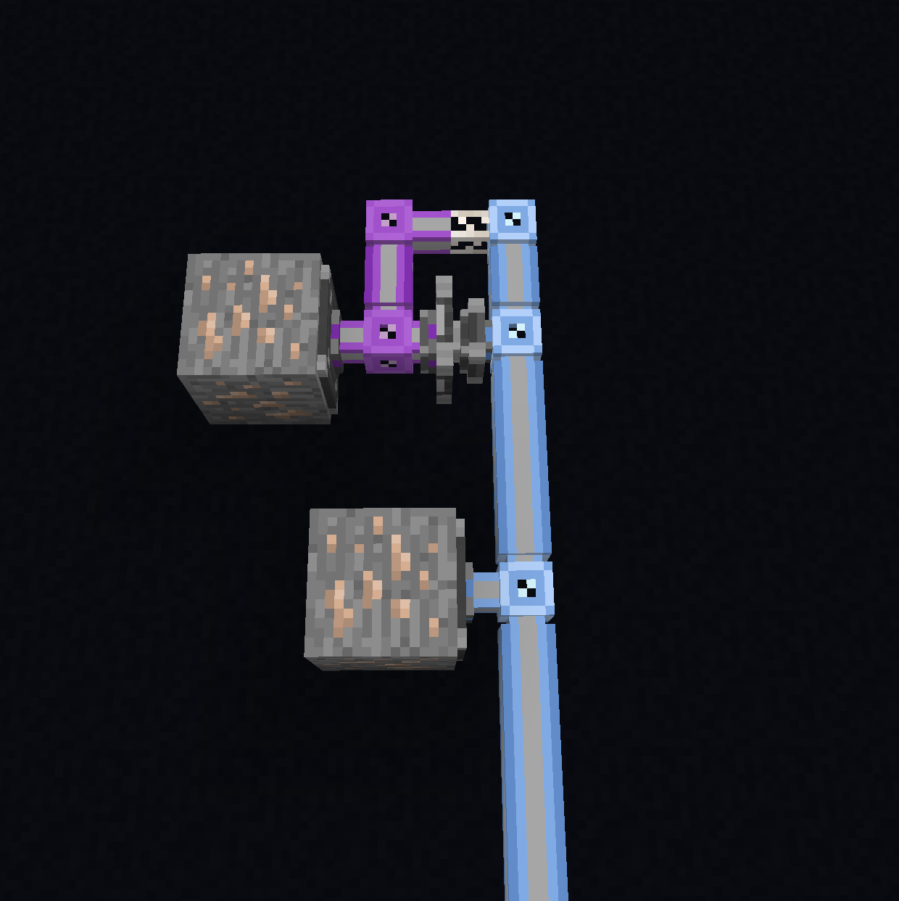

# AE2 QOL Extras

A Minecraft 1.12.2 addon for [AE2 Unofficial Extended Life](https://github.com/AE2-UEL/Applied-Energistics-2) that brings over QOL features, a lot from other AE2 versions and addons.

## Features

### Expanded Processing Pattern Terminal tweaks

Adds the ability to encode crafting patterns in the Expanded Processing Pattern Terminal, with compatibility with AE2 Fluid Crafting Rework. If you get any issues with the Expanded Processing Pattern Terminal, make an issue here before going to any other mods. There is also an option in the config to disable it.

### Spatial Link Chamber and Spatial Network Relay

Ported from the GTNH fork of AE2.

- **Spatial Link Chamber:** put a spatial storage cell in it to link it to the chamber's network. The chamber uses one channel. Use the big Dive in button to enter. Shift + right-click with empty hands does the same.
- **Spatial Network Relay:** place it inside a spatial cell. While its in a connected spatial link chamber, the relay connects to the chamber's network, giving the cell access to 31 channels, no need for a quantum link.
- **Matrix Frame:** the walls around a spatial cell can now be built against. Sneak + right click on one with an empty hand to return to the Spatial Link Chamber holding the cell.

- Make sure your network outside is chunkloaded and has power or you will not be able to get out! Also, if using the network relay, chunkload the inside of the cell so that your channels don't disconnect when you leave! If you forget and get stuck, there is this little cool command called `/forge setdimension [username] 0`.

### ME Active Formation Plane

Ported from [ExtendedAE](https://github.com/GlodBlock/ExtendedAE).

A formation plane that works like an export bus, no need for a subnet anymore.

Here is an example of constantly placing iron ore from the main net using vanilla AE2UEL vs the Active Formation Plane!

## Dependencies

- [AE2 Unofficial Extended Life](https://github.com/AE2-UEL)- v0.56.7
- Requires MixinBooter

### Optional Dependencies

- [AE2 Fluid Crafting Unofficial](https://github.com/Circulate233/AE2FluidCraft-Rework-Unofficial) - v2.7.10

## Credits

- The Spatial Link Chamber and Spatial Network Relay were designed and originally written by [kuba6000](https://github.com/kuba6000) for [GTNewHorizons/Applied-Energistics-2-Unofficial#1035](https://github.com/GTNewHorizons/Applied-Energistics-2-Unofficial/pull/1035). It is licensed under LGPL-3.0.
- The ME Active Formation Plane was designed and originally written by [GlodBlock](https://github.com/GlodBlock) for [ExtendedAE](https://github.com/GlodBlock/ExtendedAE), which is licensed under LGPL-3.0.
- [Applied Energistics 2](https://github.com/AppliedEnergistics/Applied-Energistics-2) and its [GTNH fork](https://github.com/GTNewHorizons/Applied-Energistics-2-Unofficial) are licensed under LGPL-3.0.
- Part of the Spatial Network Relay textures are from [AE2 Stuff Unofficial](https://github.com/AE2-UEL/ae2stuff). It is licensed under MIT.

## Development Notes

Parts of the code were written with the help of an AI assistant.
